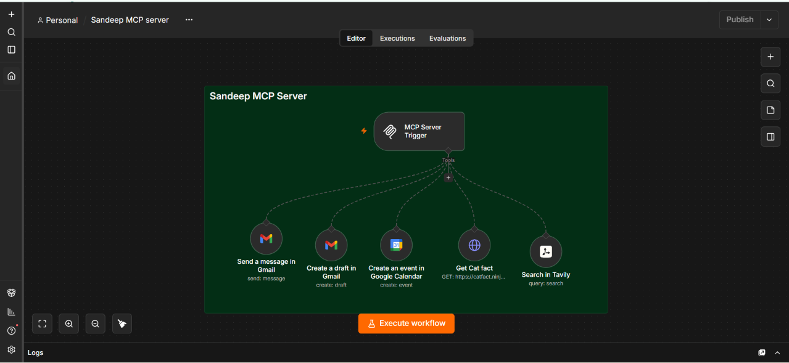
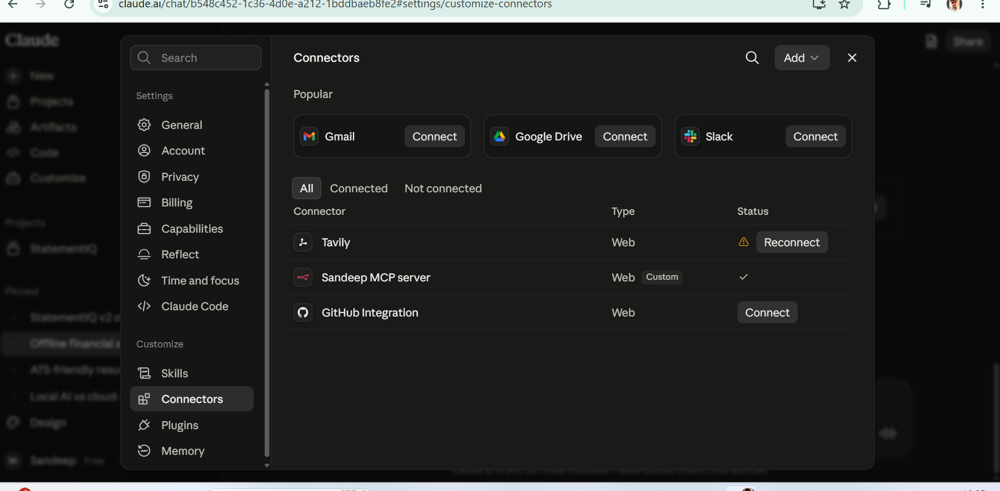
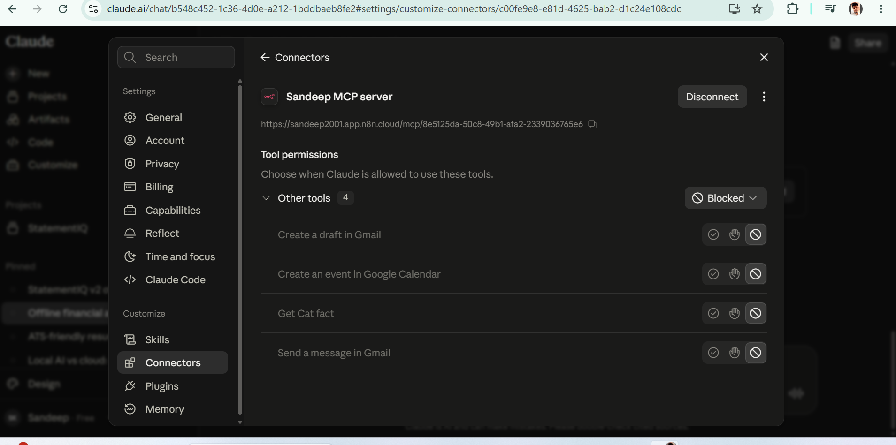

# Custom MCP Server 

A no-code/low-code integration project that exposes selected external actions to Claude through a custom **Model Context Protocol (MCP)** server built in **n8n**.

The workflow connects Claude to tools for Gmail, Google Calendar, an HTTP endpoint, and Tavily search. The screenshots document the n8n workflow and the Claude connector configuration.

## Project at a Glance

- **Workflow platform:** n8n
- **Protocol:** Model Context Protocol (MCP)
- **AI assistant:** Claude
- **Configured tools:** Gmail send message, Gmail create draft, Google Calendar create event, HTTP request, Tavily search
- **Approach:** No-code/low-code workflow integration

## Why This Project?

An AI assistant can reason and generate content, but practical tasks may require access to external services and information sources. This project explores how an MCP server can expose a defined set of tools through one connector, while n8n manages individual integrations and actions.

The MCP server acts as the tool-access layer between Claude and the configured workflow tools. Actual execution depends on credentials, node configuration, endpoint availability, and permissions enabled in Claude.

## Architecture

```text
Claude
  │ Custom MCP connector
  ▼
n8n MCP Server Trigger
  │ Tool routing
  ├── Gmail: Send a message
  ├── Gmail: Create a draft
  ├── Google Calendar: Create an event
  ├── HTTP: Get Cat Fact
  └── Tavily: Search
  │
  ▼
Tool response to Claude
```

## Tools Configured

| Tool | Purpose | Example use |
|---|---|---|
| **Gmail — Send a message** | Sends an email through the connected Gmail account | Send a message when requested |
| **Gmail — Create a draft** | Creates an email draft without sending it immediately | Prepare an email for review |
| **Google Calendar — Create an event** | Creates a calendar event | Schedule a meeting or reminder |
| **HTTP — Get Cat Fact** | Calls an external HTTP endpoint | Demonstrates exposing an API response as a tool |
| **Tavily — Search** | Runs a web search through Tavily | Retrieve search results for information gathering |

The cat-fact endpoint is an illustrative HTTP integration. Tavily is a separate search tool in the workflow.

## How the Workflow Operates

1. **Connect:** Claude connects to the custom MCP endpoint configured in n8n.
2. **Expose tools:** The MCP Server Trigger makes the workflow's configured tools available through the connector.
3. **Choose a tool:** Claude may select a relevant tool based on the user's request and the permissions available.
4. **Run the action:** n8n executes the selected operation using its configured node settings and credentials.
5. **Return the result:** The tool response can be passed back to Claude for use in its reply.

This describes the intended interaction pattern. A configured tool should not be considered successfully tested unless its execution has been verified.

## Project Screenshots

### 1. n8n Workflow

The latest workflow screenshot shows the MCP Server Trigger connected to Gmail, Google Calendar, the HTTP example, and Tavily Search.



### 2. Claude Connector Configuration

Claude's connector settings show the custom MCP server listed as a connected connector.



### 3. Claude Tool Permissions

This screenshot documents permission controls for tools exposed by the custom connector. In the captured state, the tools are shown as **Blocked**. Enable only the actions you intend to allow, then verify their behaviour before use.



## Setup Guide

### Prerequisites

- An n8n instance with support for the MCP Server Trigger
- A Claude account that supports custom MCP connectors
- Authorized Gmail credentials configured in n8n
- Authorized Google Calendar credentials configured in n8n
- A configured Tavily credential/API key if required by the Tavily node
- An HTTP endpoint for the example API tool

### Configuration Steps

1. Create a workflow in n8n and add an **MCP Server Trigger**.
2. Add the Gmail send-message and create-draft tools.
3. Add the Google Calendar create-event tool.
4. Add the HTTP request tool and configure its endpoint.
5. Add the Tavily search tool and configure its required credentials.
6. Configure each node's parameters and credentials.
7. Connect the MCP endpoint to Claude using a custom connector.
8. Review Claude's tool permissions and allow only the actions needed.
9. Test each tool with safe sample inputs and verify the execution output.

Exact node settings and authentication steps can vary by n8n version and account configuration. The original workflow export is the source of truth for the actual node setup.

## Security Considerations

- **Do not commit secrets:** Never publish API keys, access tokens, OAuth secrets, or credential values in the workflow export.
- **Inspect workflow exports:** Review the JSON before uploading it to GitHub; remove sensitive values while preserving useful configuration details.
- **Protect the MCP endpoint:** Avoid publishing private endpoint URLs or access tokens if they could expose the server.
- **Use least privilege:** Grant only the permissions required for Gmail and Calendar actions.
- **Be careful with write actions:** Sending email and creating events affect external systems. Test using safe recipients and sample events first.
- **Review tool permissions:** A connected server does not necessarily mean every tool is allowed to run in Claude.

## Scope and Limitations

This repository documents an integration prototype, not a fully hardened production service.

- Tool execution depends on n8n availability and correct node configuration.
- Gmail and Calendar actions require valid credentials and appropriate permissions.
- Tavily search depends on its configuration, credentials, and service availability.
- The HTTP tool depends on the external endpoint being available.
- Claude's tool access depends on connector permissions and applicable confirmation settings.
- Production deployment would benefit from input validation, error handling, logging, rate-limit handling, and access controls.

## Possible Next Improvements

- Add read-only Gmail search and message retrieval.
- Add calendar event lookup, update, and cancellation tools.
- Use Tavily results in a more complete research workflow.
- Improve error handling and validation for missing or invalid inputs.
- Add execution logging and monitoring.
- Add approval steps for sensitive actions.

## Repository Structure

```text
custom-mcp-server/
├── README.md
├── <original-n8n-workflow-export>.json
└── screenshots/
    ├── 01-n8n-workflow.png
    ├── 02-claude-connectors.png
    └── 03-claude-tool-permissions.png
```

Add your original n8n workflow JSON beside `README.md` before publishing. Inspect it for credentials, tokens, private URLs, email addresses, and other sensitive data first.

## Skills Demonstrated

- MCP concepts and tool connectivity
- n8n workflow design
- AI assistant integrations
- Gmail and Google Calendar integrations
- Tavily search integration
- HTTP/API tool configuration
- Connector permissions and integration security

---

**Project category:** AI integrations · No-code/low-code  
**Workflow platform:** n8n  
**AI assistant:** Claude  
**Protocol:** Model Context Protocol (MCP)
